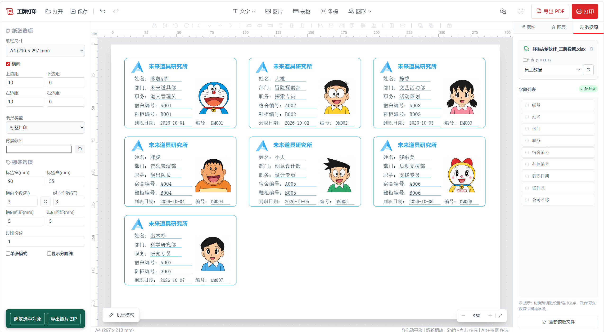

# badge-studio

适用于 Windows 的工牌排版与打印工具。导入 Excel 数据和 `.paper` 模板，即可批量生成带照片的工牌，预览后导出 PDF 或直接打印。


## 预览


## 环境要求

- Windows 10 / 11，64 位。
- 浏览器，建议使用 Microsoft Edge 或 Google Chrome。
- 直接打印时，需要安装对应打印机的驱动。

本项目附带免安装程序，无需另外安装 Python、Node.js 或第三方依赖。

## 技术栈

| 层级 | 技术 |
| --- | --- |
| 界面 | HTML、CSS、JavaScript、Tailwind CSS |
| 可视化编辑 | Fabric.js / Canvas |
| Excel 解析 | SheetJS（xlsx） |
| PDF 导出 | jsPDF、svg2pdf.js |
| 条码生成 | bwip-js |
| 本地存储 | IndexedDB、idb-keyval |
| Windows 运行环境 | 随包附带 Python 3.12 运行库，通过本地 HTTP 服务提供浏览器界面 |

仓库包含 Windows 分发程序及前端资源；不包含完整的 Python 服务端源码或构建脚本。

## 快速启动

1. 下载并完整解压项目。
2. 打开 `BadgeStudio` 文件夹，双击 **`BadgeStudio.exe`**。
3. 浏览器会自动打开工具页面。如果没有自动打开，请手动访问：

   **http://127.0.0.1:8765**

4. 使用期间保持启动窗口打开；关闭启动窗口即可停止服务。

也可以在项目根目录通过 PowerShell 启动：

```powershell
.\BadgeStudio\BadgeStudio.exe
```

> 请保持 `BadgeStudio.exe` 与 `_internal` 文件夹在同一目录。不要单独移动程序或删除 `_internal`。

## 使用示例

项目根目录提供了可直接使用的示例文件：

| 文件 | 用途 |
| --- | --- |
| `未来道具研究所_天蓝色工牌模板.paper` | 使用天蓝色折纸 A 标志的工牌模板 |
| `哆啦A梦伙伴_工牌数据.xlsx` | 包含 7 位角色资料和头像的 Excel 示例数据 |

1. 点击顶部 **打开**，选择 `.paper` 模板。
2. 在右侧 **数据源** 面板导入示例 Excel，选择 **员工数据** 工作表。如提示重新授权或选择数据源，请再次选择该文件。
3. 检查姓名、部门、职务及照片是否正确对应。
4. 根据需要调整纸张尺寸、工牌尺寸、行列数量和间距。
5. 点击 **导出 PDF** 或 **打印**，先预览再输出。
6. 修改模板后，点击 **保存**，保留为 `.paper` 文件，便于下次继续编辑。

## 目录结构

```text
BadgeStudio/
├─ README.md
├─ 哆啦A梦伙伴_工牌数据.xlsx
├─ 未来道具研究所_天蓝色工牌模板.paper
└─ BadgeStudio/
   ├─ BadgeStudio.exe       # 启动入口
   ├─ _internal/           # 程序运行所需资源
   ├─ 使用说明.txt
   └─ LICENSE
```

## 常见问题

### 页面打不开或提示端口占用

先检查启动窗口是否仍然打开。工具默认使用 `8765` 端口；如已启动过一次，请使用已有页面，或关闭旧的启动窗口后重新启动。

### 模板打开后没有数据或照片

请在数据源面板重新选择 Excel 文件，并确认工作表及字段绑定正确。模板和 Excel 是两个独立文件，需要一起保留。

### 打印位置或大小不准确

检查工具中的纸张、尺寸和边距设置，以及打印对话框中的纸张方向和缩放选项。先打印一页测试，再进行批量打印。

## 许可证

附带程序的许可证见 [BadgeStudio/LICENSE](BadgeStudio/LICENSE)。
